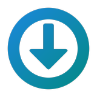
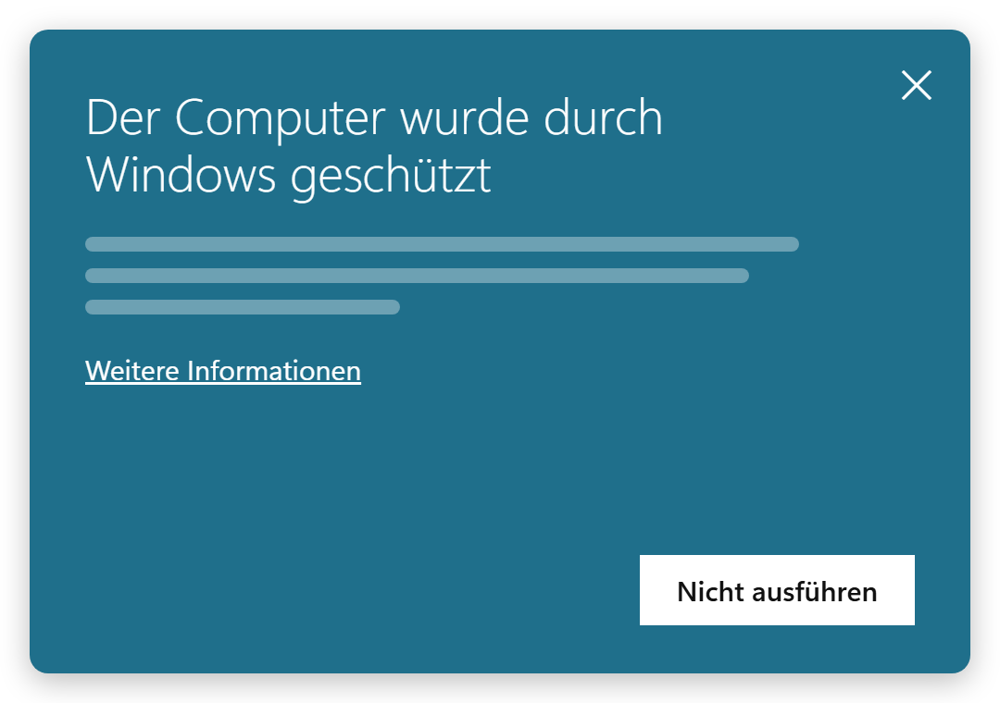

<h1 align="center">OwnGrab</h1>

Laden Sie Videos und Audio über einen Link herunter, direkt auf Ihrem Computer. Kostenlos, ohne Konto, ohne Werbung.

<a href="README.md">English</a> · <a href="README.es-MX.md">Español</a> · <b>Deutsch</b> · <a href="README.pt-BR.md">Português (Brasil)</a> · <a href="README.ru-RU.md">Русский</a> · <a href="README.uk-UA.md">Українська</a>

Windows 10 und 11 (64 Bit) · Keine Administratorrechte nötig

## In 3 Schritten installieren

**1. Herunterladen** mit der Schaltfläche oben. Meldet Ihr Browser, dass die Datei „nicht häufig heruntergeladen“ wird, öffnen Sie das Menü des Downloads (**⋯**) und wählen Sie **Beibehalten**. Fragt er erneut, wählen Sie **Mehr anzeigen** und dann **Trotzdem beibehalten**.

**2. Öffnen** Sie `OwnGrab_x64-setup.exe` in Ihrem Download-Ordner. Erscheint ein blaues Fenster „Der Computer wurde durch Windows geschützt“, klicken Sie auf **Weitere Informationen** und dann auf **Trotzdem ausführen**:

**3. Installieren:** Wählen Sie Ihre Sprache und folgen Sie dem Installationsprogramm. Fertig!

> [!TIP]
> Diese Warnungen sind bei Apps kleiner, unabhängiger Entwickler normal. Sie bedeuten „Windows kennt diesen Herausgeber noch nicht“, nicht „diese Datei ist schädlich“. Sie sehen sie nur beim ersten Mal: Updates werden in der App selbst installiert.

> [!IMPORTANT]
> Laden Sie OwnGrab nur von dieser Seite herunter. Haben Sie das Installationsprogramm woanders her, löschen Sie es.

## Erster Start

Beim ersten Start lädt OwnGrab die benötigten Komponenten herunter (etwa 300 MB). Danach fügen Sie einen Link ein, klicken auf **Analysieren** und wählen, was heruntergeladen werden soll.

## Updates

Die App aktualisiert sich selbst. Gibt es eine neue Version, erscheint ein Punkt bei **Info**: Öffnen Sie es, lesen Sie die Änderungen und klicken Sie auf **Jetzt aktualisieren**. Solange Downloads nicht abgeschlossen sind, wird nie aktualisiert. Die automatische Suche lässt sich unter **Einstellungen › Allgemein** abschalten.

<b>Warum erscheinen diese Warnungen?</b>

OwnGrab stammt von einem unabhängigen Entwickler. Windows und Browser warnen vor jeder App eines Herausgebers, den sie noch nicht kennen, und kostenpflichtige Herausgeberzertifikate sind für viele kleine Projekte unerschwinglich.

Für eine zusätzliche Prüfung scannen Sie das Installationsprogramm vor dem Öffnen mit Ihrem Virenschutz: Klicken Sie mit der rechten Maustaste auf die Datei und wählen Sie dessen Prüfoption (unter Windows 11 unter **Weitere Optionen anzeigen**).

Die Bilder oben sind eine vereinfachte Skizze: Das echte Fenster kann etwas anders aussehen, aber der Link und die Schaltflächen sind an derselben Stelle.

<b>Deinstallieren</b>

Öffnen Sie in Windows **Einstellungen › Apps › Installierte Apps › OwnGrab › Deinstallieren**. Das Deinstallationsprogramm bietet an, auch die App-Daten zu löschen; diese Option ist standardmäßig nicht aktiviert.

Löschen Sie die Daten nicht, bleiben diese Ordner zurück (Sie können sie von Hand löschen):

| Ordner | Inhalt |
| --- | --- |
| `%APPDATA%\com.nachodev.owngrab` | Einstellungen und Fensterzustand |
| `%LOCALAPPDATA%\com.nachodev.owngrab` | Heruntergeladene Komponenten (etwa 300 MB) und temporäre Dateien |

Installieren Sie neu, ohne sie zu löschen, lädt die App ihre Komponenten nicht erneut herunter. Ihre fertigen Downloads bleiben im gewählten Ordner und werden nie gelöscht.

## Lizenz

Proprietäre Software, alle Rechte vorbehalten. Siehe [LICENSE](LICENSE). Hinweise zu Drittanbietern stehen in `THIRD-PARTY-NOTICES.txt`, das neben der App installiert wird.
