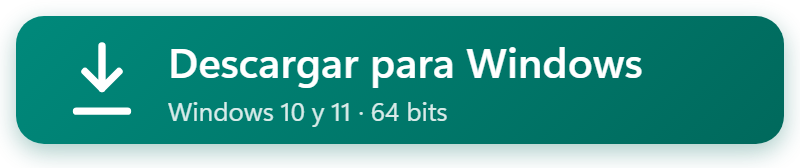
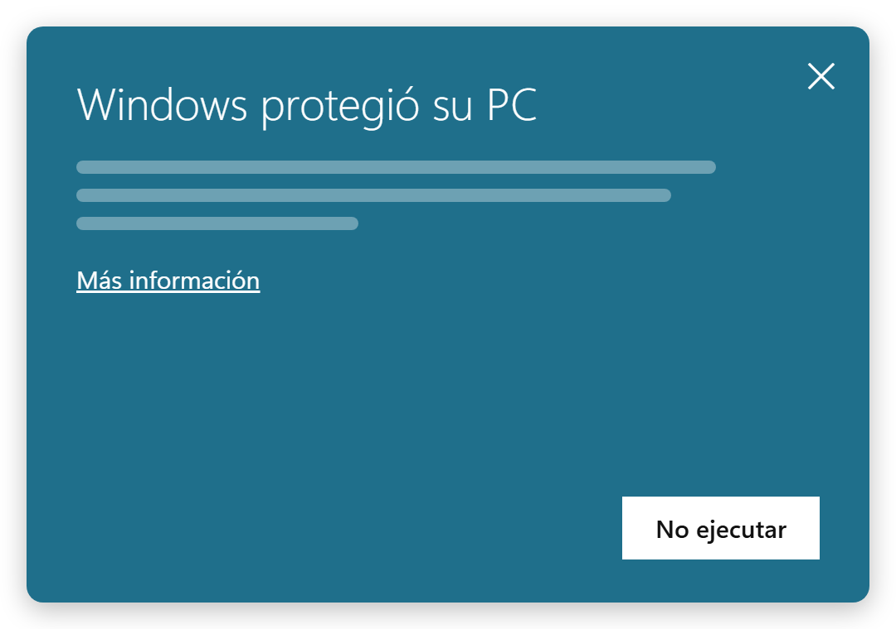

<h1 align="center">OwnGrab</h1>

Descarga video y audio desde un enlace, directo en tu computadora. Gratis, sin cuentas y sin anuncios.

<a href="README.md">English</a> · <b>Español</b> · <a href="README.de-DE.md">Deutsch</a> · <a href="README.pt-BR.md">Português (Brasil)</a> · <a href="README.ru-RU.md">Русский</a> · <a href="README.uk-UA.md">Українська</a>

Windows 10 y 11 (64 bits) · No necesita permisos de administrador

## Instálalo en 3 pasos

**1. Descarga** con el botón de arriba. Si tu navegador dice que el archivo «no se descarga con frecuencia», abre el menú de la descarga (**⋯**) y elige **Conservar**. Si vuelve a preguntar, elige **Mostrar más** y luego **Conservar de todos modos**.

**2. Abre** `OwnGrab_x64-setup.exe` desde tu carpeta de Descargas. Si aparece una ventana azul que dice «Windows protegió su PC», haz clic en **Más información** y luego en **Ejecutar de todas formas**:

**3. Instala:** elige tu idioma y sigue el instalador. ¡Listo!

> [!TIP]
> Estos avisos son normales en apps de desarrolladores pequeños e independientes. Significan «Windows todavía no conoce a este editor», no «este archivo es dañino». Solo los verás la primera vez: las actualizaciones se instalan desde la propia app.

> [!IMPORTANT]
> Descarga OwnGrab solo desde esta página. Si conseguiste el instalador en otro lado, bórralo.

## Primer inicio

La primera vez, OwnGrab descarga los componentes que necesita (unos 300 MB). Después pega un enlace, haz clic en **Analizar** y elige qué descargar.

## Actualizaciones

La app se actualiza sola. Cuando sale una versión nueva, aparece un punto en **Acerca de**: ábrelo, lee qué cambió y haz clic en **Actualizar ahora**. Nunca se actualiza mientras haya descargas sin terminar. Puedes desactivar la búsqueda automática en **Ajustes › General**.

<b>¿Por qué aparecen estos avisos?</b>

OwnGrab lo hace un desarrollador independiente. Windows y los navegadores avisan de cualquier app de un editor que todavía no reconocen, y los certificados de editor de pago están fuera del alcance de muchos proyectos pequeños.

Si quieres una revisión extra, analiza el instalador con tu antivirus antes de abrirlo: haz clic derecho en el archivo y elige la opción de análisis de tu antivirus (en Windows 11, dentro de **Mostrar más opciones**).

Las imágenes de arriba son un boceto simplificado: la ventana real puede verse un poco distinta, pero el enlace y los botones están en el mismo lugar.

<b>Desinstalar</b>

En Windows, ve a **Configuración › Aplicaciones › Aplicaciones instaladas › OwnGrab › Desinstalar**. El desinstalador ofrece borrar también los datos de la app; esa opción viene desmarcada.

Si no borras los datos, quedan estas carpetas (puedes borrarlas a mano):

| Carpeta | Contenido |
| --- | --- |
| `%APPDATA%\com.nachodev.owngrab` | Ajustes y estado de la ventana |
| `%LOCALAPPDATA%\com.nachodev.owngrab` | Componentes descargados (unos 300 MB) y archivos temporales |

Si reinstalas sin borrarlas, la app no vuelve a descargar sus componentes. Tus descargas terminadas se quedan en la carpeta que elegiste y nunca se borran.

## Licencia

Software propietario, todos los derechos reservados. Consulta [LICENSE](LICENSE). Los avisos de terceros están en `THIRD-PARTY-NOTICES.txt`, instalado junto a la app.
