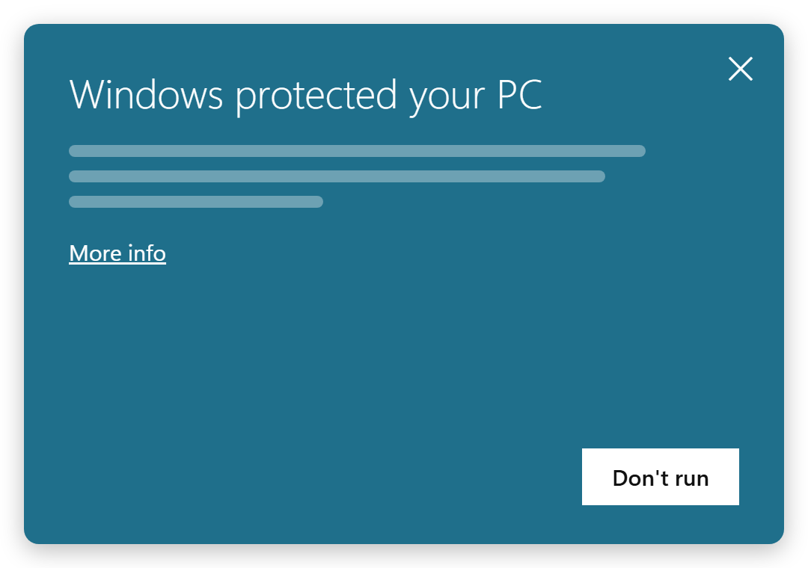

<h1 align="center">OwnGrab</h1>

Download video and audio from a link, right on your computer. Free, no accounts, no ads.

<b>English</b> · <a href="README.es-MX.md">Español</a> · <a href="README.de-DE.md">Deutsch</a> · <a href="README.pt-BR.md">Português (Brasil)</a> · <a href="README.ru-RU.md">Русский</a> · <a href="README.uk-UA.md">Українська</a>

Windows 10 and 11 (64-bit) · No administrator rights needed

## Install in 3 steps

**1. Download** with the button above. If your browser says the file "isn't commonly downloaded", open the download's menu (**⋯**) and choose **Keep**. If it asks again, choose **Show more** and then **Keep anyway**.

**2. Open** `OwnGrab_x64-setup.exe` from your Downloads folder. If a blue window says "Windows protected your PC", click **More info** and then **Run anyway**:

**3. Install:** pick your language and follow the installer. Done!

> [!TIP]
> These warnings are normal for apps from small independent developers. They mean "Windows does not know this publisher yet", not "this file is harmful". You only see them the first time: updates install from inside the app.

> [!IMPORTANT]
> Download OwnGrab only from this page. If you got the installer anywhere else, delete it.

## First launch

The first time, OwnGrab downloads the components it needs (about 300 MB). Then paste a link, click **Analyze** and choose what to download.

## Updates

The app updates itself. When a new version is out, a dot appears on **About**: open it, read what changed and click **Update now**. It never updates while downloads are unfinished. You can turn the automatic check off in **Settings › General**.

<b>Why do these warnings appear?</b>

OwnGrab is made by an independent developer. Windows and browsers warn about any app from a publisher they do not recognize yet, and paid publisher certificates are out of reach for many small projects.

For an extra check, scan the installer with your antivirus before opening it: right-click the file and choose your antivirus's scan option (on Windows 11, under **Show more options**).

The pictures above are a simplified sketch: the real window may look slightly different, but the link and the buttons are in the same place.

<b>Uninstall</b>

Go to **Settings › Apps › Installed apps › OwnGrab › Uninstall** in Windows. The uninstaller offers to delete the app data as well; that option is unchecked by default.

If you do not delete the data, these folders stay behind (you can delete them by hand):

| Folder | Contents |
| --- | --- |
| `%APPDATA%\com.nachodev.owngrab` | Settings and window state |
| `%LOCALAPPDATA%\com.nachodev.owngrab` | Downloaded components (about 300 MB) and temporary files |

If you reinstall without deleting them, the app does not download its components again. Your finished downloads stay in the folder you chose and are never deleted.

## License

Proprietary software, all rights reserved. See [LICENSE](LICENSE). Third-party notices are in `THIRD-PARTY-NOTICES.txt`, installed next to the app.
