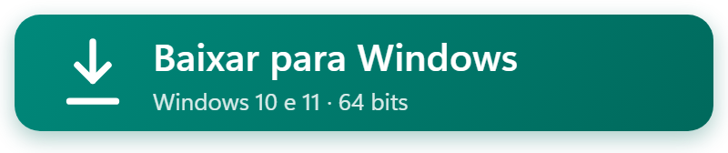
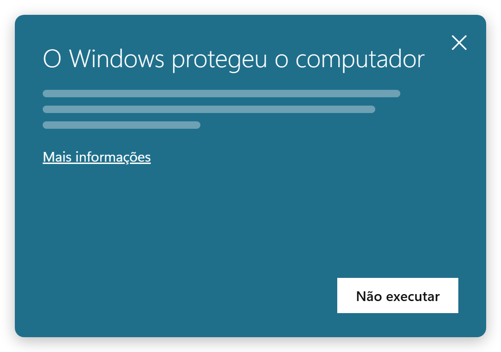

<h1 align="center">OwnGrab</h1>

Baixe vídeo e áudio a partir de um link, direto no seu computador. Grátis, sem contas e sem anúncios.

<a href="README.md">English</a> · <a href="README.es-MX.md">Español</a> · <a href="README.de-DE.md">Deutsch</a> · <b>Português (Brasil)</b> · <a href="README.ru-RU.md">Русский</a> · <a href="README.uk-UA.md">Українська</a>

Windows 10 e 11 (64 bits) · Não precisa de permissões de administrador

## Instale em 3 passos

**1. Baixe** com o botão acima. Se o navegador disser que o arquivo “não é baixado com frequência”, abra o menu do download (**⋯**) e escolha **Manter**. Se ele perguntar de novo, escolha **Mostrar mais** e depois **Manter mesmo assim**.

**2. Abra** `OwnGrab_x64-setup.exe` na sua pasta Downloads. Se aparecer uma janela azul dizendo “O Windows protegeu o computador”, clique em **Mais informações** e depois em **Executar assim mesmo**:

**3. Instale:** escolha seu idioma e siga o instalador. Pronto!

> [!TIP]
> Esses avisos são normais em apps de desenvolvedores pequenos e independentes. Eles significam “o Windows ainda não conhece este editor”, não “este arquivo é prejudicial”. Você só os vê na primeira vez: as atualizações são instaladas de dentro do app.

> [!IMPORTANT]
> Baixe o OwnGrab somente por esta página. Se você conseguiu o instalador em outro lugar, apague-o.

## Primeira execução

Na primeira vez, o OwnGrab baixa os componentes de que precisa (cerca de 300 MB). Depois, cole um link, clique em **Analisar** e escolha o que baixar.

## Atualizações

O app se atualiza sozinho. Quando sai uma versão nova, aparece um ponto em **Sobre**: abra, veja o que mudou e clique em **Atualizar agora**. Ele nunca atualiza enquanto houver downloads não concluídos. Você pode desativar a verificação automática em **Configurações › Geral**.

<b>Por que esses avisos aparecem?</b>

O OwnGrab é feito por um desenvolvedor independente. O Windows e os navegadores avisam sobre qualquer app de um editor que ainda não reconhecem, e certificados de editor pagos estão fora do alcance de muitos projetos pequenos.

Para uma verificação extra, examine o instalador com seu antivírus antes de abri-lo: clique com o botão direito no arquivo e escolha a opção de verificação do antivírus (no Windows 11, em **Mostrar mais opções**).

As imagens acima são um esboço simplificado: a janela real pode ser um pouco diferente, mas o link e os botões ficam no mesmo lugar.

<b>Desinstalar</b>

No Windows, vá em **Configurações › Aplicativos › Aplicativos instalados › OwnGrab › Desinstalar**. O desinstalador oferece apagar também os dados do app; essa opção vem desmarcada.

Se você não apagar os dados, estas pastas ficam no computador (você pode apagá-las manualmente):

| Pasta | Conteúdo |
| --- | --- |
| `%APPDATA%\com.nachodev.owngrab` | Configurações e estado da janela |
| `%LOCALAPPDATA%\com.nachodev.owngrab` | Componentes baixados (cerca de 300 MB) e arquivos temporários |

Se você reinstalar sem apagá-las, o app não baixa os componentes de novo. Seus downloads concluídos ficam na pasta que você escolheu e nunca são apagados.

## Licença

Software proprietário, todos os direitos reservados. Veja [LICENSE](LICENSE). Os avisos de terceiros estão em `THIRD-PARTY-NOTICES.txt`, instalado junto com o app.
