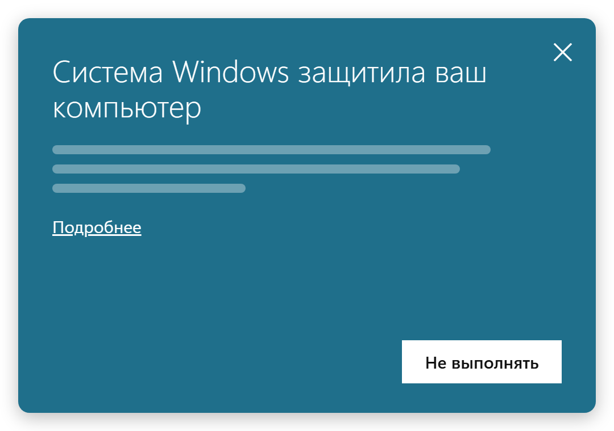

<h1 align="center">OwnGrab</h1>

Скачивайте видео и аудио по ссылке прямо на своём компьютере. Бесплатно, без учётных записей и без рекламы.

<a href="README.md">English</a> · <a href="README.es-MX.md">Español</a> · <a href="README.de-DE.md">Deutsch</a> · <a href="README.pt-BR.md">Português (Brasil)</a> · <b>Русский</b> · <a href="README.uk-UA.md">Українська</a>

Windows 10 и 11 (64-разрядная) · Права администратора не нужны

## Установка за 3 шага

**1. Скачайте** файл кнопкой выше. Если браузер сообщит, что файл «нечасто скачивают», откройте меню загрузки (**⋯**) и выберите **Сохранить**. Если он спросит ещё раз, выберите **Показать больше**, а затем **Всё равно сохранить**.

**2. Откройте** `OwnGrab_x64-setup.exe` из папки «Загрузки». Если появится синее окно «Система Windows защитила ваш компьютер», нажмите **Подробнее**, а затем **Выполнить в любом случае**:

**3. Установите:** выберите язык и следуйте указаниям установщика. Готово!

> [!TIP]
> Такие предупреждения обычны для приложений небольших независимых разработчиков. Они означают «Windows пока не знает этого издателя», а не «этот файл опасен». Вы увидите их только в первый раз: обновления устанавливаются из самого приложения.

> [!IMPORTANT]
> Скачивайте OwnGrab только с этой страницы. Если вы получили установщик из другого места, удалите его.

## Первый запуск

При первом запуске OwnGrab скачивает нужные компоненты (около 300 МБ). Затем вставьте ссылку, нажмите **Анализировать** и выберите, что скачать.

## Обновления

Приложение обновляется само. Когда выходит новая версия, на пункте **О программе** появляется точка: откройте его, прочитайте, что изменилось, и нажмите **Обновить сейчас**. Пока есть незавершённые загрузки, обновление не устанавливается. Автоматическую проверку можно отключить в разделе **Настройки › Общие**.

<b>Почему появляются эти предупреждения?</b>

OwnGrab создаёт независимый разработчик. Windows и браузеры предупреждают о любом приложении от издателя, которого они ещё не знают, а платные сертификаты издателя недоступны многим небольшим проектам.

Для дополнительной проверки просканируйте установщик антивирусом перед запуском: щёлкните файл правой кнопкой мыши и выберите пункт проверки вашего антивируса (в Windows 11 — в разделе **Показать дополнительные параметры**).

Изображения выше — упрощённая схема: настоящее окно может выглядеть немного иначе, но ссылка и кнопки находятся на тех же местах.

<b>Удаление</b>

В Windows откройте **Параметры › Приложения › Установленные приложения › OwnGrab › Удалить**. Программа удаления предложит удалить и данные приложения; по умолчанию этот вариант не отмечен.

Если не удалять данные, останутся эти папки (их можно удалить вручную):

| Папка | Содержимое |
| --- | --- |
| `%APPDATA%\com.nachodev.owngrab` | Настройки и состояние окна |
| `%LOCALAPPDATA%\com.nachodev.owngrab` | Скачанные компоненты (около 300 МБ) и временные файлы |

Если переустановить приложение, не удаляя их, компоненты не будут скачиваться заново. Готовые загрузки остаются в выбранной вами папке и никогда не удаляются.

## Лицензия

Проприетарное программное обеспечение, все права защищены. См. [LICENSE](LICENSE). Уведомления о сторонних компонентах находятся в файле `THIRD-PARTY-NOTICES.txt`, который устанавливается рядом с приложением.
