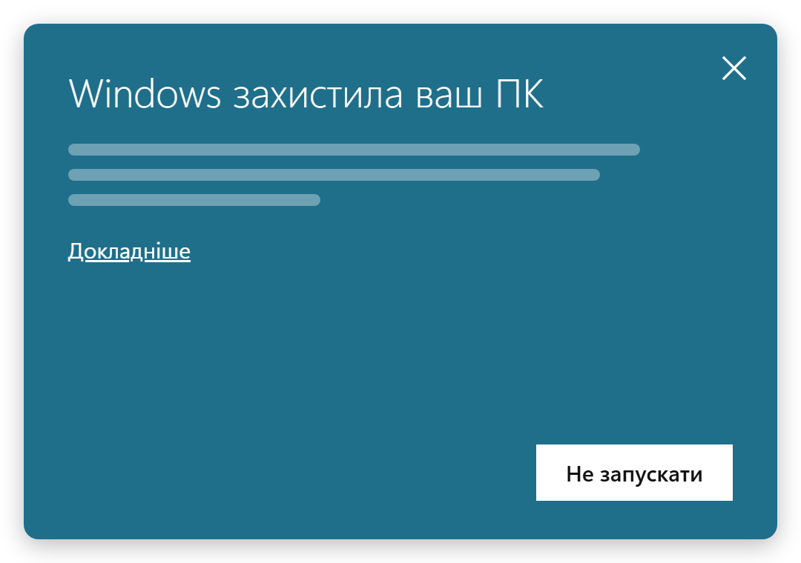

<h1 align="center">OwnGrab</h1>

Завантажуйте відео й аудіо за посиланням просто на своєму комп’ютері. Безкоштовно, без облікових записів і без реклами.

<a href="README.md">English</a> · <a href="README.es-MX.md">Español</a> · <a href="README.de-DE.md">Deutsch</a> · <a href="README.pt-BR.md">Português (Brasil)</a> · <a href="README.ru-RU.md">Русский</a> · <b>Українська</b>

Windows 10 і 11 (64-розрядна) · Права адміністратора не потрібні

## Встановлення за 3 кроки

**1. Завантажте** файл кнопкою вище. Якщо браузер повідомить, що файл «нечасто завантажують», відкрийте меню завантаження (**⋯**) і виберіть **Зберегти**. Якщо він запитає знову, виберіть **Показати більше**, а потім **Усе одно зберегти**.

**2. Відкрийте** `OwnGrab_x64-setup.exe` з папки «Завантаження». Якщо з’явиться синє вікно «Windows захистила ваш ПК», натисніть **Докладніше**, а потім **Усе одно запустити**:

**3. Встановіть:** виберіть мову й дотримуйтеся вказівок інсталятора. Готово!

> [!TIP]
> Такі попередження звичайні для застосунків невеликих незалежних розробників. Вони означають «Windows ще не знає цього видавця», а не «цей файл шкідливий». Ви побачите їх лише першого разу: оновлення встановлюються із самого застосунку.

> [!IMPORTANT]
> Завантажуйте OwnGrab лише з цієї сторінки. Якщо ви отримали інсталятор деінде, видаліть його.

## Перший запуск

Під час першого запуску OwnGrab завантажує потрібні компоненти (близько 300 МБ). Потім вставте посилання, натисніть **Аналізувати** й виберіть, що завантажити.

## Оновлення

Застосунок оновлюється сам. Коли виходить нова версія, на пункті **Про застосунок** з’являється крапка: відкрийте його, прочитайте, що змінилося, і натисніть **Оновити зараз**. Поки є незавершені завантаження, оновлення не встановлюється. Автоматичну перевірку можна вимкнути в розділі **Налаштування › Загальні**.

<b>Чому з’являються ці попередження?</b>

OwnGrab створює незалежний розробник. Windows і браузери попереджають про будь-який застосунок від видавця, якого вони ще не знають, а платні сертифікати видавця недоступні багатьом невеликим проєктам.

Для додаткової перевірки проскануйте інсталятор антивірусом перед запуском: клацніть файл правою кнопкою миші й виберіть пункт перевірки вашого антивірусу (у Windows 11 — у розділі **Показати більше параметрів**).

Зображення вище — спрощена схема: справжнє вікно може виглядати трохи інакше, але посилання й кнопки розташовані на тих самих місцях.

<b>Видалення</b>

У Windows відкрийте **Настройки › Програми › Інстальовані програми › OwnGrab › Видалити**. Програма видалення запропонує видалити й дані застосунку; за замовчуванням цей варіант не позначено.

Якщо не видаляти дані, залишаться ці папки (їх можна видалити вручну):

| Папка | Вміст |
| --- | --- |
| `%APPDATA%\com.nachodev.owngrab` | Налаштування та стан вікна |
| `%LOCALAPPDATA%\com.nachodev.owngrab` | Завантажені компоненти (близько 300 МБ) і тимчасові файли |

Якщо перевстановити застосунок, не видаляючи їх, компоненти не завантажуватимуться повторно. Готові завантаження залишаються у вибраній вами папці й ніколи не видаляються.

## Ліцензія

Пропрієтарне програмне забезпечення, усі права захищено. Див. [LICENSE](LICENSE). Повідомлення про сторонні компоненти містяться у файлі `THIRD-PARTY-NOTICES.txt`, який встановлюється поруч із застосунком.
